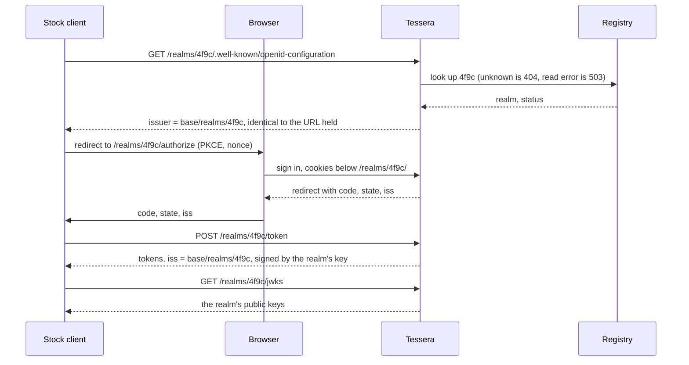

# ADR-IAM-011 — A realm is chosen by its issuer URL, and a realm is one opaque id

| Field | Value |
|---|---|
| Status | **Proposed** |
| Date | 2026-11-07 |
| Amends, once accepted | [ADR-IAM-003](ADR-IAM-003-tenant-tier-and-path-scoped-issuer.md) D1, D2, D3, D4 and D5; [ADR-IAM-002](ADR-IAM-002-standalone-public-origin.md) D1 consequence 7 and its rejected alternative on the path; [ADR-IAM-005](ADR-IAM-005-oidf-basic-op-conformance-in-ci.md) D1 consequence 2 |
| Relates to | [ADR-IAM-007](ADR-IAM-007-token-exchange-and-agent-delegation-profile.md) (`act.iss`), [ADR-IAM-009](ADR-IAM-009-sender-constraint-refresh-binding-and-audience.md) (audience and the operator's declaration), [ADR-IAM-010](ADR-IAM-010-security-floor-and-tenant-profiles.md) (profiles; `fapi2` waits for per-realm issuers) |

---

## Background

An OpenID Connect client is configured with one thing: an issuer URL. It appends `/.well-known/openid-configuration`, reads the endpoints from the document, and refuses the document if its `issuer` is not identical to the URL it used (OIDC Discovery §4 and §4.3). Tessera must work for that client, because tessera is a provider other people adopt.

In single-tenant mode it does. In multi-tenant mode it does not. The realm comes from two request headers, a tenant id and an optional baseline id, which a gateway is expected to set. A request without them is a `400`, on discovery too, so a client holding only an issuer URL stops at its first request.

Facts the decisions rest on:
- No standard defines these headers. OIDC Core, OIDC Discovery and RFC 6749, 7009, 7517, 7662, 8414, 8707, 9068 and 9449 define no tenant, realm or baseline request header. They do define the answer: a path in the issuer "enables supporting multiple issuers per host", which is "required in some multi-tenant hosting configurations" (RFC 8414 §3, OIDC Discovery §4).
- `TenantResolutionFilter` checks nothing about who set the headers. Whoever reaches the server chooses the realm.
- ADR-IAM-003 planned per-realm issuers and kept the headers as the source of the realm. None of that plan is built. There is no registry, no realm route, and one configured issuer that every mint path, every client-assertion audience and the discovery document share.
- A realm is the pair `(tenant, baseline)`. A baseline is a version of an application's configuration, which no identity standard has a concept of. Seven tables carry `baseline_id`, so a user or a client exists separately per baseline, while signing keys are per tenant. A new configuration version would be a new empty set of users.
- Tokens carry two non-standard claims, `realm_tenant` and `realm_baseline`. Only the end-session endpoint compares them. Introspection checks a signature and an expiry and compares neither the claims nor `iss`, so ADR-IAM-003 D4b's second boundary does not exist yet.
- `tessera_session` is set with `Path=/`. Rows sit behind row-level security keyed by tenant, so a cookie from one tenant finds nothing in another.
- `iam.subject.trust-header`, off by default, makes `/authorize` issue a code for whatever `X-Subject-Id` says, with no sign-in. ADR-IAM-010 D1 proposes removing it.
- Nothing can create a realm in multi-tenant mode. First-boot provisioning requires a fixed tenant, and ADR-IAM-009 D5's writer is not built.
- A stock confidential client without a certificate is refused a token by default, and a public client needs DPoP. These are floor rules and have nothing to do with realms, but they limit what "only an issuer URL" can mean.

What other identity servers do, read on 2026-11-07:

| Server | How a realm is chosen | What a stock client needs | Source |
|---|---|---|---|
| Keycloak | Path: `/realms/{realm-name}/.well-known/openid-configuration`, and every endpoint below that path. Realms are isolated from one another. The hostname is configured, not resolved from the request, which the guide calls "a security measure". A proxy overwrites forwarded headers | The realm's URL | `keycloak.org/securing-apps/oidc-layers`, `/server/hostname`, `/server/reverseproxy`, Server Administration Guide; pages for the latest version |
| Spring Authorization Server | Path: an issuer with a path component represents the "tenant identifier", and the issuer is the base URL of the protocol endpoints. It answers at both `/issuer1/.well-known/openid-configuration` and `/.well-known/oauth-authorization-server/issuer1` | The issuer URL | `docs.spring.io/spring-authorization-server/reference/guides/how-to-multitenancy.html` |
| Amazon Cognito | Path: `https://cognito-idp.<region>.amazonaws.com/<user pool id>/.well-known/openid-configuration` | The pool's URL | `docs.aws.amazon.com/cognito/latest/developerguide/federation-endpoints.html` |
| Microsoft Entra ID | Path: the tenant is in the authority URL, and the configuration document is the authority plus the well-known path | The authority URL | `learn.microsoft.com/en-us/entra/identity-platform/v2-protocols-oidc` |
| ZITADEL | Host: the `Host` header picks a virtual instance. An ordered, configurable list (`InstanceHostHeaders`, default `x-zitadel-instance-host`) lets a proxy state the host in another header | The instance's URL | `zitadel.com/docs/self-hosting/manage/custom-domain`, `cmd/defaults.yaml` on `main` |

All five put the realm in the URL a client is given. ZITADEL is the one with a configurable header, and what it carries is the host of that URL, so the client's URL still decides.

## D1 — The issuer URL alone chooses the realm

**Decision.** With no fixed realm configured, the issuer of a realm is `base/realms/<opaque id>`, and every route of that realm is below it: discovery, JWKS, `/authorize`, `/token`, `/introspect`, `/revoke`, `/end_session`, the hosted sign-in, consent and logout routes, and `/userinfo` and `/par` when they are built. The RFC 8414 location, `/.well-known/oauth-authorization-server/realms/<opaque id>`, is served as well, and it stays at the root because that standard puts it there. `/assets/themes` also stays at the root, because a theme holds nothing private and belongs to no realm (ADR-IAM-008). Every other root route answers `404`, and there is no default realm.

**What it means.** The realm is read from the matched route parameter, checked for form, and looked up in the registry (D1 of ADR-IAM-003). Only then is it bound to `TenantContext`, and only then does the transaction set the row-security variable. Naming a realm is not a credential. It decides whose clients, users and keys a request is checked against, and it grants nothing.

| A caller who names realm B can | A caller who names realm B cannot |
|---|---|
| Read B's discovery document and public keys | Read a row of B without B's credentials |
| See B's hosted sign-in page | Get a token without authenticating as a client or user of B |
| Try a credential against B, under B's budgets | Use a token, code, refresh token, assertion or session from realm A in B |

**Declared states.** One configuration point, `iam.tenancy.fixed-realm`, replaces `iam.tenancy.fixed-tenant`. A malformed value still stops the server at startup. So does a leftover `iam.tenancy.fixed-tenant`, because ignoring it would silently turn a fixed deployment into one that serves realms by URL.

| State | Set by | Realm comes from | Issuer | Protects | Costs | Who picks it |
|---|---|---|---|---|---|---|
| Fixed realm | `iam.tenancy.fixed-realm=<id>` | Configuration; a request cannot influence it | `base`, with routes at the root; `/realms/*` is `404` | The smallest attack surface | One realm per deployment | A deployment for one organisation, or a central provider with one user base |
| Realms by URL | Unset | The issuer URL | `base/realms/<id>`, with routes below it; the root is `404` | Many realms on one origin, each a standard issuer | A registry, and one key set per realm | A deployment hosting separate organisations |

Both states are at the floor of ADR-IAM-010, and in both a request header decides nothing. Moving between them changes `iss`, so ADR-IAM-003 D3 consequences 4 and 5 stand.

**Consequences.**
1. A stock client reaches any realm with its issuer URL and sends nothing tessera-specific, as the walkthrough below shows. Getting a token also takes a client registration that meets the floor (D4).
2. Fail-closed tenancy keeps its shape. An unknown or malformed id is the same `404` and touches no tenant data. A registry read error is a `503`, never a default. A realm that is not bound leaves rows invisible under `FORCE ROW LEVEL SECURITY`, as today.
3. The raw path is not parsed. Encoded `/`, dot segments, matrix parameters and case variants are refused, as ADR-IAM-003 D2 consequence 2 requires. The forwarded-prefix setting stays off.
4. One function derives the issuer from the configured base and the realm id, and never from `Host`. `UseCaseProducer` stops handing one issuer string to the services, and every mint path, `AuthorizationResponses` (the `iss` of RFC 9207), `NimbusClientAssertionVerifier` and `DiscoveryDocument` asks that function.
5. A client assertion's `aud` is its realm's issuer. An assertion made for realm A is refused in realm B at the audience check, before any replay store. A workload's platform token must be minted for that audience.
6. `iam.oidc.issuer` keeps its meaning as `base`, and `IssuerConsistencyCheck` compares bases. A proxy keeps the realm path byte for byte (ADR-IAM-003 D3 consequence 8).
7. Cookies are scoped to the path of the realm's issuer, including any mount base. Today a sign-in to a second realm in the same browser overwrites the first realm's session cookie. Redirects and cookie paths come from the issuer function, not from the request's base URI as `AuthorizeResource` and `SignInCookies` build them today. A path decides where a cookie is sent, not what a script on the same origin can read, so row-level security stays the barrier and the subdomain argument below applies.
8. Realm resolution runs before the rate limiter, so it must cost nothing for an id that does not exist. The filter answers from an in-memory snapshot of the registry, refreshed on a configured interval, and a miss never reads the database. Random ids cost one hash lookup and grow no state, and the filter stays synchronous, as it is today. A new realm answers after the next refresh. The interval is the bound on suspension that ADR-IAM-003 D1 consequence 2 asks for. A snapshot older than a configured limit is a `503`.
9. The per-tenant Argon2 share keeps its documented limit: several flooded realms together can fill the global cap. A caller could already do that with the headers, and the global cap stays the limit.
10. Discovery and JWKS have distinct URLs per realm, so the shared-cache defect of ADR-IAM-003 D5 consequence 3 ends, and `Vary` is not needed in either state.
11. `fapi2` opens to deployments with many realms, as ADR-IAM-010 D2 provides, because each realm has its own document.
12. A refresh token's realm is compared with the request's realm before client authentication and before anything rotates, and a mismatch is `invalid_grant` with the family unchanged. `RefreshService` compares them today only after rotation. It issues nothing, but the live token is spent, so the holder's next refresh burns the family. A caller choosing the realm by URL makes this easy to reach, so the comparison moves first, and it is step 0 below.
13. `iam.subject.trust-header` is removed before realm routes ship, not bound to a realm. With it on and the realm chosen by URL, `/authorize` would issue a code for any `sub` in any realm. Binding it to a realm changes nothing, because the header is still unauthenticated. A leftover setting fails startup.
14. A workload's issuer and subject become unique per realm, not globally. The global index exists because the audience was one issuer for all tenants, and consequence 5 ends that. It would also stop one workload from serving a staging and a production realm, and it tells one realm that a pair exists in another. Squatting gains nothing: a realm that registers someone else's pair receives no token from that workload, because the platform token names only the realm the workload chose, and `aud` must be exactly one value. Which issuers are trusted stays operator configuration. The index changes in the same step as the audience, not before.

**Why this reverses ADR-IAM-002 and ADR-IAM-003.** Those records rejected "the path as the tenant source" because it "lets the caller choose the tenant". That holds if the choice is an authority. On a provider that a stranger's browser must reach before anyone has signed in, the choice cannot be an authority, and tessera does not treat it as one: the boundaries are per-realm credentials, per-realm keys and row-level security. A gateway that strips and overwrites the header does stop a caller choosing, but tessera cannot verify that one is there, and a gateway of that kind is what a stock client does not have.

**Why not per-realm subdomains by default.** Subdomains are the serious alternative, and ZITADEL's model. They give each realm its own browser origin, so a script on one realm's page cannot reach another's, and `__Host-` cookies work. A wildcard DNS record and one wildcard certificate remove most of the per-tenant cost ADR-IAM-003 cited, so that is not the reason to refuse them. The costs that remain are these. The realm comes from `Host`, so a value the caller sends is matched against a template, where a path uses a matched route parameter. Internal callers need split-horizon DNS for a wildcard. Sibling hosts can set cookies on the parent domain unless it is on the Public Suffix List. A hosting platform must support wildcard mappings, which was not checked for any platform. A path gives up origin isolation, and this record accepts that because tessera serves no realm-authored script: the sign-in page has its own Content-Security-Policy, and themes are CSS and static assets shipped with the image (ADR-IAM-008). A stock client works the same either way. This reopens if realm-authored script ever reaches a page, or an adopter hosts mutually hostile realms and wants origins between them. It would then be a third declared state on the same registry.

## D2 — A realm is one opaque id; baseline leaves tessera

**Decision.** `RealmKey(tenant, baseline)` becomes one server-minted opaque id. `BaselineId`, the `baseline_id` columns, the `realm_tenant` and `realm_baseline` claims and the zero-baseline convention are removed. The registry of ADR-IAM-003 D1 holds realms: id, tier, status and security profile. Tessera has no concept above a realm.

**What it means.** A user, a client, a session and a key set belong to a realm, and `(iss, sub)` identifies one user, as OIDC Core §2 expects. An application that versions its configuration keeps those versions in its own services. One that wants to separate staging from production uses two realms. One that groups realms by customer keeps that grouping itself.

**Consequences.**
1. The schema is edited in place and databases are recreated. No release carries data that must survive, so there is no backfill.
2. The row-security column and variable keep their mechanism and take the realm's name.
3. Signing keys are per realm. The D3 amendment's gap in ADR-IAM-003, where signatures could not separate two baselines, is gone. One key set per realm counts against the KMS quota (ADR-IAM-003 D4 consequence 6).
4. The second boundary is built here, and it is `iss`. The change that makes the issuer per realm (step 4) adds the comparison to `IntrospectService` and moves `EndSessionService` from realm claims to `iss`. A token without `iss` or `exp` is then inactive. Until that step, `realm_tenant` stays and carries the realm id, so end-session keeps its check. Step 4 removes it. Neither boundary is then a custom claim.
5. A relying party that needs its own tenant in a token gets it from a per-user claim through `ClaimSourcePort`, or maps `iss` itself. A relying party that reads `realm_tenant` must move first, so the per-user claim ships before the claims are removed.
6. Tier and security profile are per realm. Where ADR-IAM-010 says "tenant", read "realm". ADR-IAM-009 D5's declaration is keyed by realm and client. `act.iss` in ADR-IAM-007 is unchanged, because it was always the issuer URL.
7. The change is wide and mostly mechanical: 44 main Java files mention a baseline, 29 of them through the type, the accessor, the column or the claim, and 96 main and 48 test files use `RealmKey`.

## D3 — Tessera reads no realm-selecting header, and has no extension point for one

**Decision.** `TenantHeaders` and its header names are removed from code, OpenAPI, `application.properties`, the performance scripts, and the README, which documents the two states instead. No configuration names a header, and no resolver port is added. A forged header has nothing to read it.

**What it means.** A gateway in front of tessera is an ordinary OIDC client (ADR-IAM-002) or a plain router. It may terminate TLS, route, and rate-limit. It does not select a realm for tessera. What a deployment's gateway asserts to its own services is that deployment's business, in that deployment's configuration.

**Consequences.**
1. Every adopter gets the same security story: the tessera code that chooses a realm is small, public and the same everywhere.
2. A test sends each former header, and any other, to each route: with a realm path it changes nothing, and with no realm path it is a `404`. A build rule refuses a read of such a header in the realm filter.
3. Conformance has one route to test, and the result applies to every deployment.
4. An adopter who wanted a custom header writes a route rule that rewrites the path instead, which is a standard proxy feature. The issuer stays the canonical URL, as consequence 6 of D1 requires.

**Why not a configurable header, off by default.** It looks like a free compatibility option, and for most clients it is not. A client using discovery on a shared URL, with a header added by the edge, gets one of two answers. If `iss` is the shared base, two realms share `(iss, sub)`, which ADR-IAM-003 D3 forbids. If `iss` is the realm's URL, the client aborts at the check of OIDC Discovery §4.3. A client configured statically with its endpoints and expected `iss` skips that check, so a header can work for it on the back channel. The browser step still fails, because a browser sends no such header, and an edge can only derive it from the host or path, which means the URL has already chosen. So a header helps only machine clients behind an edge that knows their realm, and those can use the realm's URL just as well. Keeping the floor would also take a proof that the sender is the edge, such as mTLS, plus `Vary` or `private` caching and a second conformance run, for a state no known deployment uses.

**What would reopen this.** An adopter with a real deployment where the realm cannot be in the URL its clients use. The state would then have to be off by default, name its header only in that deployment's configuration, require an authenticated connection from the edge or fail startup, set `Vary` to that name, and keep the realm's own `iss`.

## D4 — Compatibility is proven by a stock client and the conformance suite

**Decision.** Two tests prove this record, and it is not implemented until both run.

1. **Stock clients, on every build.** Two unmodified libraries in different languages, `openid-client` for Node and Quarkus OIDC, each given only an issuer URL and client credentials, complete sign-in and refresh against a server with two realms in the realms-by-URL state. No test helper sets a realm header or calls a tessera-specific route. The default floor stays on, so the clients are registered to meet it: one with `sender_constraint=dpop`, using `openid-client`'s own DPoP support, and one with `none`, which ADR-IAM-009 D1 allows when `iam.security.allow-unbound-clients` is set. Until ADR-IAM-009 ships, the DPoP case is a public client, the only kind that can use DPoP today, and the unbound case runs with `iam.authflow.require-sender-constraint=false` on that test server. `openid-client` uses `client.discovery(issuer, …)`, which by default reads the OIDC location and refuses an `issuer` that differs, and it also runs with `algorithm: 'oauth2'` for the RFC 8414 location (read in `openid-client` and `oauth4webapi` sources, `main`, on 2026-11-07). Quarkus OIDC runs against the OIDC location only, since whether it reads the other location was not established.
2. **The OpenID Foundation suite, nightly.** ADR-IAM-005's harness stops needing fixed-tenant mode. The Basic OP plan runs against a realm's issuer, and also against a fixed realm, under ADR-IAM-005's rule on a committed list of known failures. ADR-IAM-005's three gaps still come first: nothing here is a conformance claim until then.

**Consequences.**
1. A failure-path matrix runs beside them, one behaviour and one input per case, in two real realms under real row-level security: a token, a code, a refresh token, an assertion and a session cookie from realm A, each presented in realm B; an unknown id; a malformed id; and a spoofed `Host`, generalising `DiscoveryEndpointTest.issuerIsConfiguredNotHost`.
2. A stock client configured with nothing but a URL and a secret is still refused a token unless its registration allows that. The issuer URL settles how a client reaches a realm. Whether it may have an unbound token stays the registration's decision, and no realm rule weakens it.

## D5 — A realm is created by an administrative step, whole

**Decision.** One administrative step creates a realm as a unit, under the administrative database role: it mints the id, writes the registry row as `provisioning`, mints and activates the first key set under ADR-IAM-001's custody, applies the declared clients through ADR-IAM-009 D5's use case, and only then sets the status to `active`. There is no network endpoint until a provisioning API is decided.

**What it means.** A realm answers only when it can sign. First-boot provisioning becomes this same step for the fixed realm. An operator gets the minted id from the step and keys later declarations by it.

| Status | Discovery and JWKS | `/authorize` and sign-in | `/token` | `/introspect` | `/revoke` |
|---|---|---|---|---|---|
| Unknown, `provisioning` or `closed` | `404` | `404` | `404` | `404` | `404` |
| `active` | `200` | Normal | Normal | Normal | Normal |
| `suspended` | `200` | `403` error page, with no redirect to the client | `invalid_client` | `active: false` | Accepted |

**Consequences.**
1. A suspended realm keeps its metadata, because keys are public and a missing document would look like a library or network fault. Issued access tokens still verify locally until they expire, which a provider cannot prevent.
2. A closed id is never reused (ADR-IAM-003 D3).
3. A realm's first key signs without the dwell, as at first boot (ADR-IAM-003 D5), because nothing can have cached its key set.
4. `SigningKeyReadinessCheck` stops falling back to `DevTenant` outside the development profile, and `iam.readiness.signing-key.tenant` is removed. With a fixed realm it probes that realm. With realms by URL, readiness means the snapshot is fresh and the database reachable. One realm with no usable key answers `503` on its own mint paths and takes no other realm down.

## What a stock client does, step by step

The client knows an issuer URL and its own credentials.

**Today, multi-tenant.** No realm has a URL of its own, so the client can only hold the shared base.
1. `GET /.well-known/openid-configuration` carries no tenant header, because the client has none to send, and the answer is a `400`.
2. Sign-in cannot start.

**With this record.** The client holds `https://id.example/realms/4f9c`.
1. `GET /realms/4f9c/.well-known/openid-configuration`. The server looks up `4f9c`, and the document's `issuer` is the URL the client holds, so validation passes.
2. The browser goes to `/realms/4f9c/authorize` with PKCE and a `nonce`. No session means the hosted sign-in, whose cookies are below the realm's path.
3. The user signs in. The redirect carries `code`, `state` and `iss`, which the client compares (RFC 9207).
4. The client posts to `/realms/4f9c/token`. A client assertion, if used, names the issuer as `aud`. The client's registration decides what it must also present: a DPoP proof if it is `dpop`, a certificate if `mtls`, nothing more if `none`.
5. The client fetches `/realms/4f9c/jwks`, verifies the ID token and compares `iss`.
6. A later refresh goes to the same `/token`. No step used a tessera-specific request. Only the registration was tessera's.

**With a configurable header instead.** Step 1 goes to a shared URL, with a header added by an edge. The answer's `issuer` then either differs from the URL, so the client aborts, or is shared by every realm, so `(iss, sub)` no longer identifies a user. A statically configured client skips step 1 and reaches `/token`, but its browser still cannot complete step 2 without the edge deriving the realm from the URL. If the edge routes by host, so that the URL differs per realm, then the URL is what chooses and the header adds nothing.

**With baseline removed and the headers kept.** The client's path is the same as today's multi-tenant path. D2 alone does not help a stock client, which is why D1 and D2 go together: D1 makes a realm reachable, and D2 makes one URL mean one realm.

## Order of work

| Step | Change | Needs |
|---|---|---|
| 0 | Compare the refresh token's realm before rotation; remove `iam.subject.trust-header` | Nothing |
| 1 | The per-user claim from `ClaimSourcePort`, so relying parties can leave the realm claims | Nothing |
| 2 | Remove baseline: one realm id, per-realm keys, schema edited in place. `realm_baseline` goes, and `realm_tenant` stays with the realm id | Step 1 |
| 3 | The registry holding realms, its snapshot, and D5's creation step and readiness rule | Step 2 |
| 4 | Issuer per realm, realm routes, cookies, audience, workload index, headers removed. `iss` compared in introspection and end-session, and `realm_tenant` removed | Step 3 |
| 5 | Per-realm discovery and JWKS, the RFC 8414 location, the TTL-under-dwell check | Step 4 |
| 6 | Stock-client tests in the build, conformance against a realm's issuer | Step 5, and ADR-IAM-005's gaps for conformance |

Single-tenant deployments keep working at every step. Until step 4, the existing multi-tenant mode keeps its cache defect, and its discovery and JWKS answers should be `Cache-Control: private` rather than naming the headers in `Vary`.

## Rejected alternatives

- **Rename the header to `X-Realm`.** It is still a header no standard client sends, and RFC 6648 deprecates the prefix.
- **A configurable trusted header, off by default.** See D3.
- **A realm-resolver port for deployments to implement.** The same outcome for a stock client as a header, and a security decision moved into code the project does not review.
- **Keep the path-must-agree rule of ADR-IAM-003 D2.** It leaves every stock client dependent on a gateway, and a request with both has one fact stated twice.
- **Keep baseline as a hidden second key, always zero.** Dead columns, and a second id every reader must learn is meaningless.
- **Keep a tenant above the realm.** Nothing in the standards or the code needs it once a realm is one id, and a deployment can group realms itself.
- **Choose the realm from a query parameter, `login_hint` or `acr_values`.** A client does not send one at discovery, and the keys differ per realm before any sign-in.
- **Per-realm subdomains by default.** See D1. Origin isolation is a real gain, and it is deferred until realm-authored script exists.
- **A realm id that validates itself, with a keyed tag.** It rejects random ids without a lookup, but rotating the key would invalidate issuer URLs that relying parties pin. The snapshot does the same with no key.
- **A per-source budget before the registry.** Source addresses are spoofable until trusted proxies are pinned, and a shared address penalises its neighbours.
- **Bind `X-Subject-Id` to the realm.** See D1 consequence 13.

## Open items

1. **How the routes are declared.** JAX-RS gives a class one path, and fixed-realm mode serves the same resources at the root. A sub-resource locator is the likely shape. Whether Quarkus REST applies the name-bound `TenantScoped` filter across a locator must be shown by a test before step 4 is planned. A pre-matching rewrite is the fallback, and it needs ADR-IAM-003 D2 consequence 2's refusals before it.
2. **A realm's own issuer name.** Some adopters will want `https://id.acme.example` for one realm. Keycloak's realm settings have a Frontend URL field. It would be a declared, verified value in the registry, and it is left out until someone needs it.
3. **The client-certificate header.** `X-Client-Certificate` is the same kind of custom name, though off by default and already generic. RFC 9440 defines `Client-Cert` for this, with rules on removing a client's own value (§2.4). Moving to it is a separate, small change.
4. **Review status.** An independent review's findings are applied in this version. Nothing here is implemented. Acceptance is the maintainers' decision.
